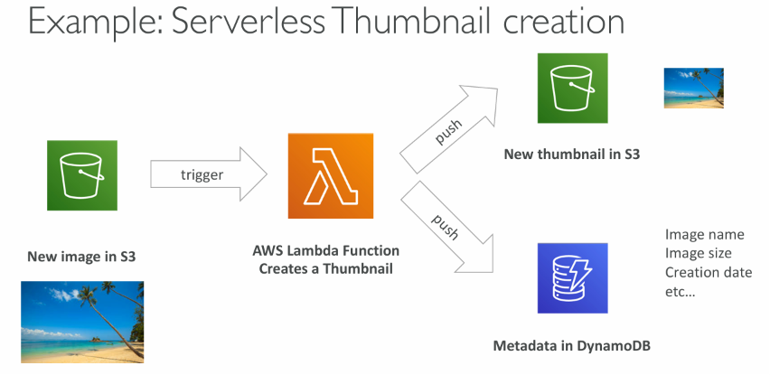
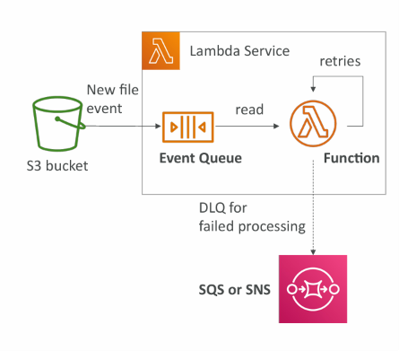
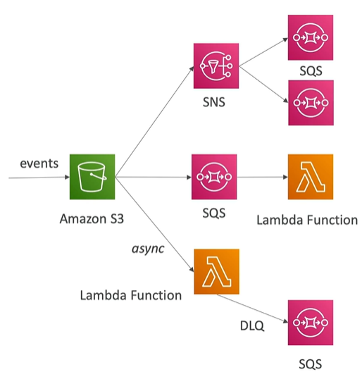

# AWS Lambda

What’s serverless?
Serverless was pioneered by AWS Lambda but now also includes
anything that’s managed: “databases, messaging, storage, etc.”

Serverless does not mean there are no servers…
it means you just don’t manage / provision / see them

- Virtual functions – no servers to manage!
- Limited by time - short executions
- Run on-demand
- Scaling is automated!

### Common Serverless Services in AWS

- AWS Lambda
- DynamoDB
- AWS Cognito
- AWS API Gateway
- Amazon S3
- AWS SNS & SQS
- AWS Kinesis Data Firehose
- Aurora Serverless
- Step Functions
- Fargate



### Hands On

```
1. Go to Lambda from AWS Console
2. Click Create Function
3. Select "Author from scratch"/ Use blue print
4. Enter Function name: HelloWorld
5. Select Runtime
6. Click Create Function

To write code
1. Go to function → Code
2. Write code
3. Click Deploy

To test function
1. Go to function → Test
2. Click Test
```

## Synchronous Lambda - Direct Invocation

You wait till get response. Invoke via CLI, SDK, API Gateway, Application Load Balancer. Error handling must happen client side.

## Lambda Integration with ALB

- To expose a Lambda function as an HTTP(S) endpoint…
- You can use the Application Load Balancer (or an API Gateway)
- The Lambda function must be registered in a target group

Hands on

```
1. Create Lambda Function
2. Create ALB
3. Create Target Group with targetType Lambda Function
4. Select Or create lambda function -> Register in target group
5. Select create TG in ALB configuration
6. create ALB
```

### ALB Multi-Value Headers

ALB can support multi-value headers (ALB setting). When you enable multi-value headers, HTTP headers and query string parameters that
are sent with multiple values are shown as arrays within the AWS Lambda event and response objects.

## Lambda – Asynchronous Invocations

The events are placed in an Event Queue

- Lambda attempts to retry on errors
- 3 tries total
- 1 minute wait after 1st , then 2 minutes wait
- Make sure the processing is idempotent (in case of retries)
- If the function is retried, you will see duplicate logs entries in CloudWatch Logs
- Can define a DLQ (dead-letter queue) – SNS or SQS – for failed processing (need correct IAM permissions)
- Asynchronous invocations allow you to speed up the processing if you don’t need to wait for the result (ex: you need 1000 files processed)



Hands On

```
1. Create Lambda Function
2. Add permission to access DLQ
    1. go to configuration → permissions → add permissions/policy
    2. Add statement (Select actions: sqs:SendMessage, Resource: DLQ ARN)
3. Create DLQ SQS Queue
4. Go to Asynchronous Invocations and add DLQ
5. Test function to verify DLQ
```

## S3 Event Notifications
- S3:ObjectCreated, S3:ObjectRemoved, S3:ObjectRestore, S3:Replication etc.
- Object name filtering possible (*.jpg)
- Use case: Generate thumbnails of images

Ways to trigger Lambda from S3


Hands on ( simle - Direct S3 -> Lambda )
1. Create Lambda function
2. Create S3 bucket
3. Go to S3 bucket → Properties → Event Notifications → Create Event Notification
    - Select event type (ex: All object create events)
    - Select Lambda function as destination


## Lambda Event source mapping SQS - Hands on
1. Create SQS queue
2. Create Lambda function
3. Go to Lambda function → Configuration → Triggers → Add trigger
4. Select SQS as trigger type
5. Attach lambdaSQSQueueExecutionRole to lambda
6. Send SQS message
7. Watch CloudWatch logs for Lambda function execution 
